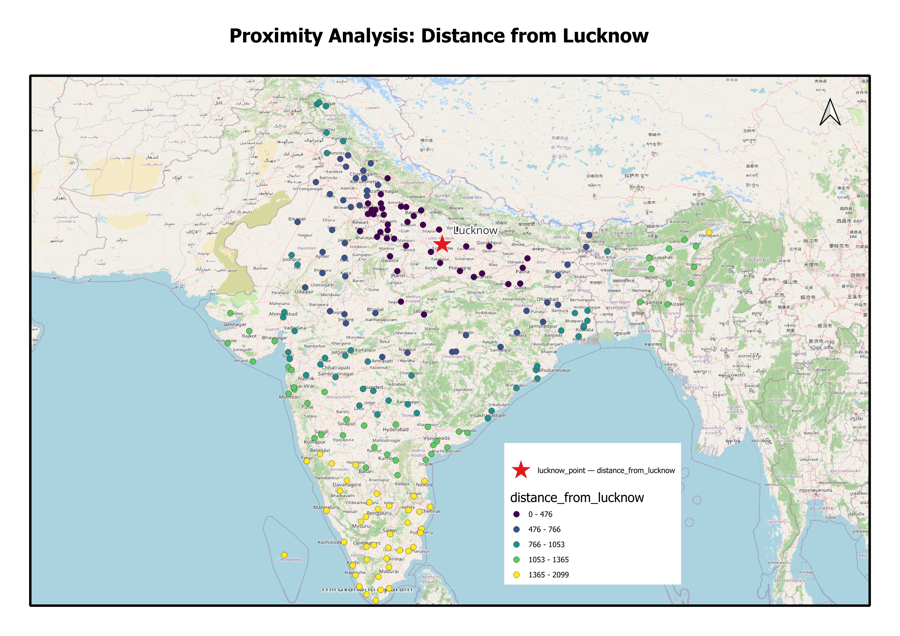

# Proximity Analysis: Distance from Lucknow to 200+ Indian Cities

## Objective
Measure how far 212 Indian cities are from Lucknow, and find how many cities and people lie within different distances of it.

## Key Findings
- Nearest city: Cawnpore (Kanpur), about 74 km from Lucknow
- Farthest city: Nagercoil, about 2,099 km away
- 8 cities lie within 200 km, with about 5.6 million people
- 46 cities lie within 500 km, with about 43.8 million people
- 117 cities lie within 1,000 km, with about 114.4 million people
- 177 of the 212 cities lie within 1,500 km
- The five farthest cities are all in the far south or the Andaman Islands (Nagercoil, Port Blair, Thiruvananthapuram, Quilon, Tinnevelly)

## Method
1. Loaded a world cities dataset and filtered it to India
2. Calculated the geodesic distance (along the Earth's surface) from Lucknow to every city using geopy
3. Found the 5 nearest and 5 farthest cities
4. Counted cities and population within 200, 500, 1000 and 1500 km
5. Exported the results to CSV
6. Mapped the distances in QGIS using five distance classes

## Tools
Python (pandas, geopy), QGIS

## How to Run
1. Install the packages in a conda environment (pandas, geopy, jupyter)
2. Open `proximity-analysis-lucknow.ipynb` in VS Code or Jupyter
3. Run all cells from top to bottom

## Project Structure
- `proximity-analysis-lucknow.ipynb`: analysis notebook
- `data/worldcities.csv`: input data
- `output/distance_from_lucknow.csv`: distance of every Indian city from Lucknow
- `output/distance_summary.csv`: cities and population within each distance limit
- `output/proximity_analysis_map_lkw.png`: final map made in QGIS

## Limitations
- Distances are straight-line, not road or rail distances
- Population covers only the cities listed in the dataset, not whole regions
- Each limit includes the nearer cities, so the counts are cumulative
- City names follow the dataset's spellings (for example, Cawnpore is Kanpur)

## Notes
Built as a learning project. The distance calculation is adapted from the Spatial Thoughts Python Foundation course exercise, and I extended it with the nearest/farthest cities and the population-within-distance analysis. AI tools helped with debugging and structure.

## Credits
City data: worldcities.csv. Basemap: OpenStreetMap contributors.